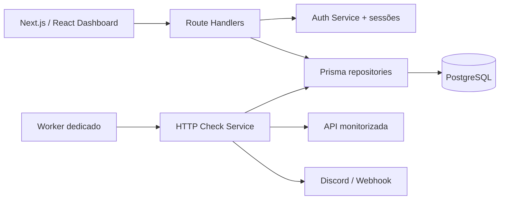

# Pulsewatch

Dashboard SaaS para monitorização de APIs e webhooks, com health checks automáticos, métricas de latência, histórico de disponibilidade e alertas por webhook. Os dados são persistidos em PostgreSQL com Prisma ORM.

## Funcionalidades

- Login e registo com passwords protegidas por `scrypt`, tokens de sessão armazenados como hash e cookie `httpOnly`.
- Confirmação obrigatória de email e recuperação de senha com tokens de uso único.
- Isolamento dos monitores por utilizador.
- CRUD de monitores com método HTTP, intervalo, timeout, headers e webhook de alerta.
- Checks HTTP reais, automáticos e manuais.
- Estados `UP`, `DOWN` e `PENDING`, uptime e latência.
- Alertas de indisponibilidade e recuperação.
- Dashboard responsivo com Recharts, Tailwind CSS e Lucide.
- API REST validada com Zod.
- PostgreSQL 17, migrations e seed idempotente com Prisma 7.
- Worker de monitorização separado do processo web.
- Retenção automática de checks e alertas para controlar o crescimento do banco.
- Build standalone e ambiente Docker Compose.

## Executar

Requer Node.js 22.12+ e uma instância PostgreSQL.

```bash
cp .env.example .env
npm install
npm run db:generate
npm run db:migrate
npm run db:seed
npm run dev
```

A aplicação estará em [http://localhost:3000](http://localhost:3000).

Conta demo:

```text
Email: demo@pulsewatch.dev
Senha: pulsewatch
```

Com Docker:

```bash
docker compose up --build
```

O comando cria o PostgreSQL, aplica as migrations, executa o seed e inicia separadamente a aplicação e o worker.

### Emails em desenvolvimento

O Compose também inicia o Mailpit. As mensagens de confirmação e recuperação ficam disponíveis em [http://localhost:8025](http://localhost:8025); nenhuma mensagem de desenvolvimento é enviada para a internet.

Ao executar sem Docker e sem `SMTP_HOST`, a resposta da API inclui um link de pré-visualização visível apenas em desenvolvimento. Para SMTP real, configure `SMTP_HOST`, `SMTP_PORT`, `SMTP_USER`, `SMTP_PASSWORD`, `SMTP_SECURE` e `SMTP_FROM`.

## Conectar pelo DBeaver

Com o Docker Compose em execução, crie uma conexão do tipo **PostgreSQL** no DBeaver:

| Campo | Valor de desenvolvimento |
|---|---|
| Host | `localhost` |
| Port | `5432` |
| Database | `pulsewatch` |
| Username | `pulsewatch` |
| Password | `pulsewatch_dev` |
| URL JDBC | `jdbc:postgresql://localhost:5432/pulsewatch` |

A porta está exposta apenas em `127.0.0.1`, portanto o banco não fica acessível externamente. Para mudar as credenciais, copie `.env.example` para `.env` e altere `POSTGRES_USER`, `POSTGRES_PASSWORD`, `POSTGRES_DB` e `DATABASE_URL` antes do primeiro arranque.

Se o volume já tiver sido criado, mudar apenas o `.env` não altera as credenciais internas existentes. Nesse caso, preserve os dados ou recrie deliberadamente o volume de desenvolvimento.

Para inspecionar os dados sem DBeaver:

```bash
npm run db:studio
```

## Rotas

| Método | Rota | Descrição |
|---|---|---|
| `GET` | `/api/health` | Saúde da aplicação |
| `POST` | `/api/auth/login` | Iniciar sessão |
| `POST` | `/api/auth/register` | Criar conta |
| `POST` | `/api/auth/logout` | Terminar sessão |
| `POST` | `/api/auth/verify-email` | Consumir token e confirmar email |
| `POST` | `/api/auth/verify-email/request` | Reenviar confirmação |
| `POST` | `/api/auth/forgot-password` | Solicitar recuperação |
| `POST` | `/api/auth/reset-password` | Definir nova senha |
| `GET` | `/api/monitors` | Listar monitores do utilizador |
| `POST` | `/api/monitors` | Criar monitor |
| `GET` | `/api/monitors/:id` | Consultar monitor |
| `PATCH` | `/api/monitors/:id` | Atualizar ou pausar monitor |
| `DELETE` | `/api/monitors/:id` | Eliminar monitor |
| `POST` | `/api/monitors/:id/check` | Executar check imediato |

## Qualidade

```bash
npm run typecheck
npm run lint
npm run build
```

## Arquitetura atual



A aplicação web não executa o agendamento. O serviço `worker` consulta os monitores vencidos e guarda cada resultado numa transação com a atualização do estado e eventual alerta.

## Estrutura do banco

- `users`: contas e hashes de password.
- `sessions`: hashes dos tokens e expiração.
- `email_verification_tokens`: tokens de confirmação com validade de 8 horas.
- `password_reset_tokens`: tokens de recuperação com validade de 30 minutos.
- `monitors`: configuração e estado atual dos endpoints.
- `ping_logs`: histórico temporal de disponibilidade e latência.
- `alerts`: incidentes DOWN e RECOVERY.

O schema está em `prisma/schema.prisma` e a migration SQL inicial em `prisma/migrations`.
